# RiptOPL interface captures

RiptOPL includes one PSBBN theme with six layouts. Open **Settings → Interface → Theme View** to choose one, or hold **L3** while browsing the library to move to the next layout. The button bar labels L3 **View/Filter**. Tap it to cycle the library filters, or hold it to change the layout. When both actions are available, a tap shows **Hold for Theme** and a hold shows **Tap for Filter**. See [Controls](CONTROLS.md) for navigation within each layout.

## Library views

| List | Coverflow (3) |
| --- | --- |
| 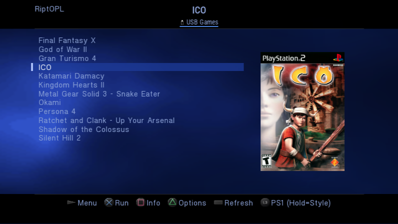 | 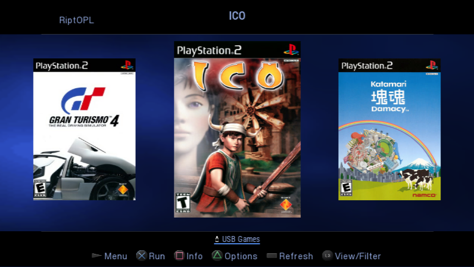 |

| Coverflow (5) | PSBBN Flow |
| --- | --- |
| 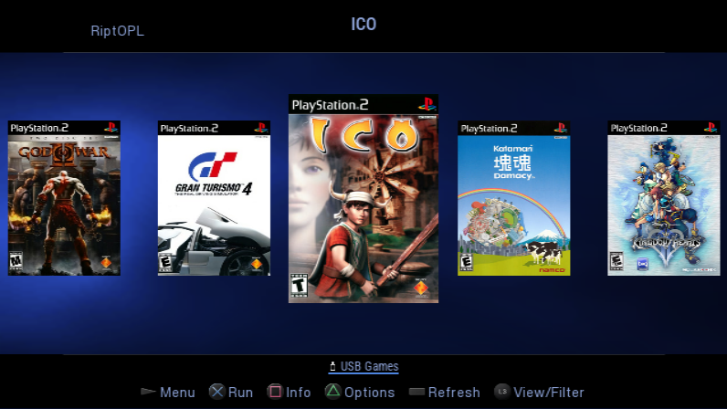 | 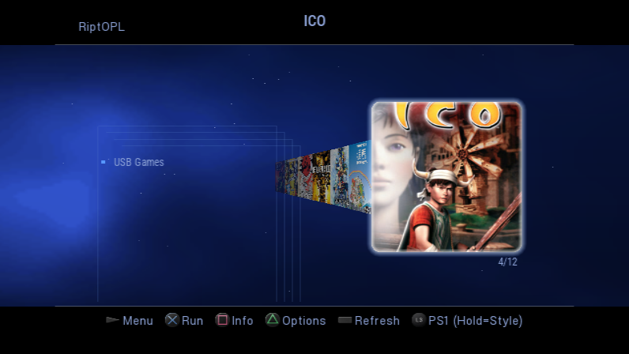 |

| Grid | Grid (7×2) |
| --- | --- |
| 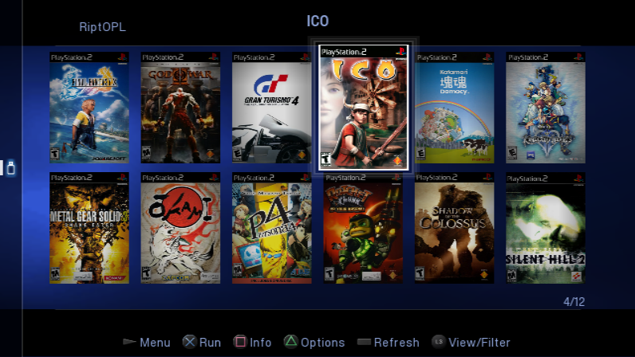 | 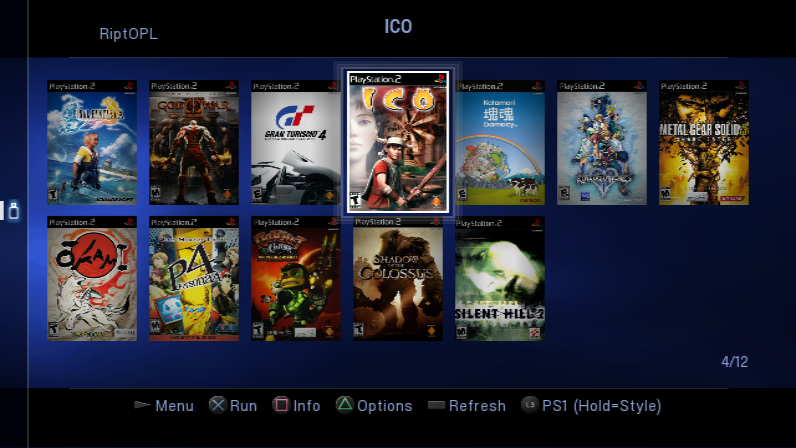 |

L1 and R1 turn pages in List and Grid or jump 15 titles in Coverflow and PSBBN Flow. Each wraps at the ends of the library.

## Game information

Press **Square** on a game. The information screen can show CFG metadata and matching cover and screenshot art.

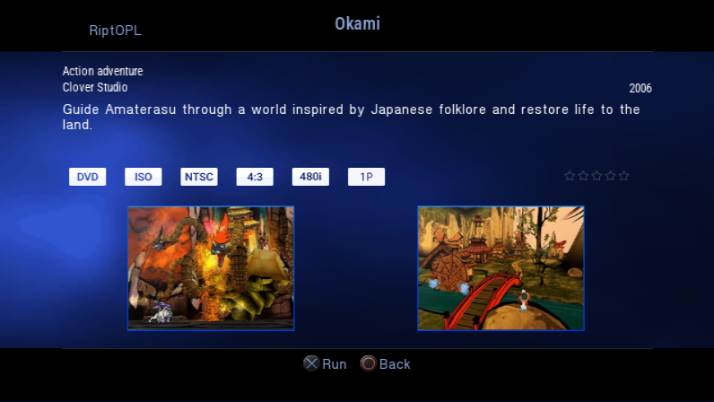

## Settings and game options

| Settings categories | Game Sources | Interface |
| --- | --- | --- |
| 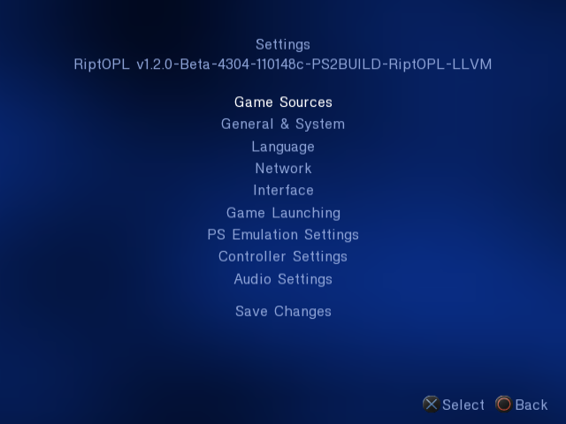 | 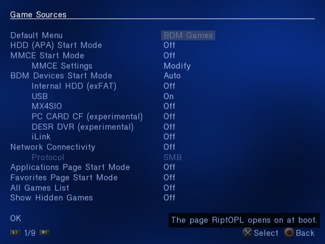 | 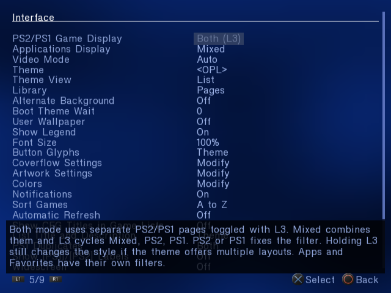 |

Press **Triangle** on a PS2 game for per-game options.

| Game Options | Game Settings |
| --- | --- |
| 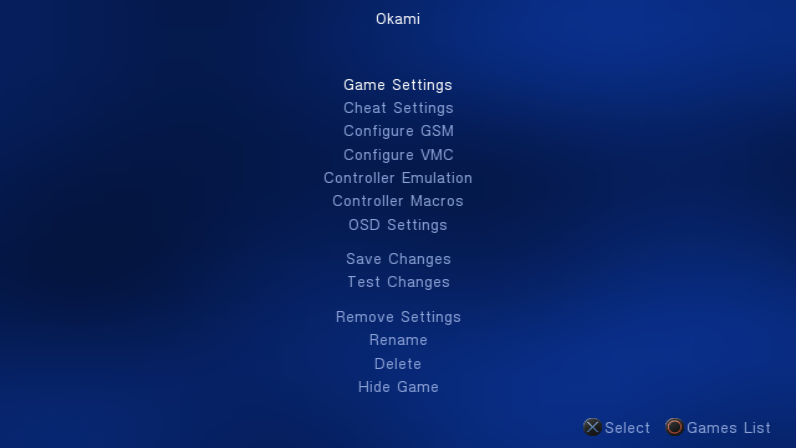 | 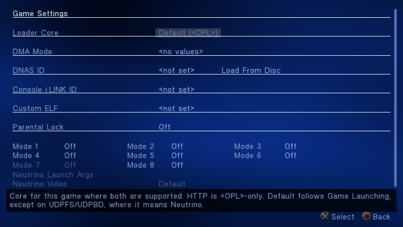 |

| Virtual Memory Cards | GSM | Cheat Settings |
| --- | --- | --- |
| 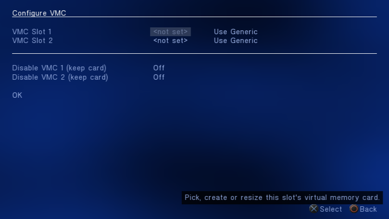 | 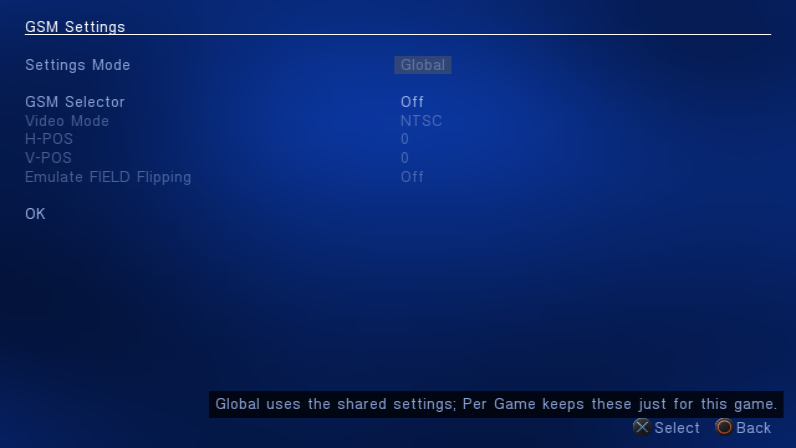 | 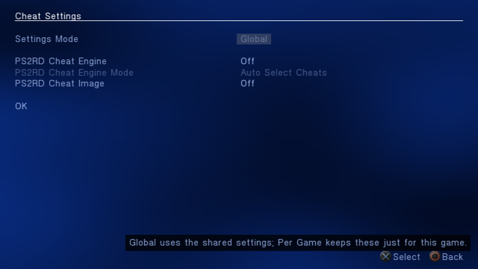 |

| Controller Emulation | Controller Macros |
| --- | --- |
| 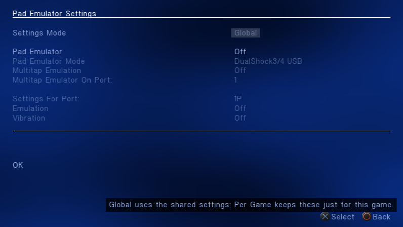 | 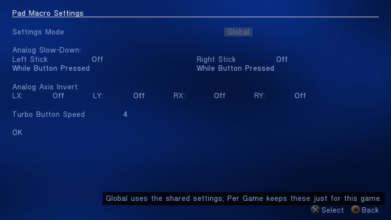 |

## Build and sample library

- **Loader:** standard RiptOPL, LLVM/Clang, source [`110148cb`](https://github.com/NathanNeurotic/RiptOPL/commit/110148cb7a47ddf2ce0fb7d5cdeff5870943336f).
- **Emulator:** [RIPPCSX2](https://gitlab.com/akilluminati247/RIPPCSX2). The library and per-game captures are widescreen. The general Settings screens use 4:3.
- **Library:** twelve non-bootable placeholder disc files on an isolated USB disk image. The titles and serials are used to demonstrate artwork and metadata matching. These captures verify menu rendering and navigation in the emulator. Launch compatibility is checked separately on real hardware.
- **Artwork:** covers from [xlenore/ps2-covers](https://github.com/xlenore/ps2-covers), matched against the PCSX2 GameIndex. Info artwork from [Luden's OPL artwork archive](https://github.com/Luden02/psx-ps2-opl-art-database). Artwork belongs to its respective owners. See the [capture manifest](assets/ui/capture-manifest.json) for build and image hashes, and [the earlier artwork manifest](https://github.com/NathanNeurotic/RiptOPL/blob/1d4b642eab3a9e54f86197120b7fc637e05fc11f/docs/assets/ui/capture-manifest.json) for the sample artwork sources.

## Refreshing the captures

1. Set up a portable RIPPCSX2 instance with its own settings and a USB image containing placeholder `DVD/` entries and matching `ART/` and `CFG/` files. Use a local BIOS from your own console. Keep BIOS, card images and sample disk images outside the repository.
2. Use the standard RiptOPL ELF and record its build manifest. Enable USB in the capture configuration, choose List and set Auto menu video and widescreen for the library. Hold L3 between captures and allow the artwork to settle. Use 4:3 when capturing the general Settings menus.
3. Use the emulator's screenshot hotkey. For repeatable pad sequences, adapt the [RIPPS2 background capture driver](https://gitlab.com/akilluminati247/RIPPS2/-/blob/f4679198071ebc6d57461111f5a70ba3e268c2e0/tools/dev/ps2bg.ps1) by [akilluminati47](https://gitlab.com/akilluminati247) to your lab. Check each frame at full size. Keep screenshots and their hashes in `docs/assets/ui/` and copy the same PNGs to `assets/ui/` on the Pages branch. Run the site and wiki generators after updating the captions.

Earlier views and recordings are available in the [archived captures guide](https://github.com/NathanNeurotic/RiptOPL/blob/1d4b642eab3a9e54f86197120b7fc637e05fc11f/docs/UI-CAPTURES.md).
