# RiptOPL interface captures

These screenshots and clips show the real RiptOPL menu running in **RIPPCSX2**.
The collection covers library views, per-game controls and settings. Each pair shows
the same screen in Korium and IncebtIon, captured from the same release source
commit with the same sample library, artwork and configuration.

## Browse the collection

The showcase uses a virtual USB disk containing 12 **non-bootable placeholder files**.
RiptOPL scans the files and renders the matching art through its normal UI. No games
are distributed or launched in the published media.

### Five-cover carousel

| Korium | IncebtIon |
| --- | --- |
|  | 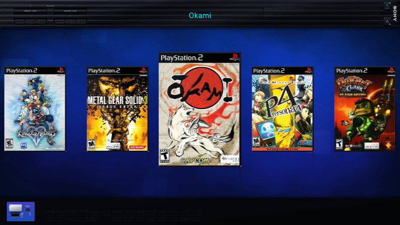 |

### Three-cover carousel

| Korium | IncebtIon |
| --- | --- |
|  | 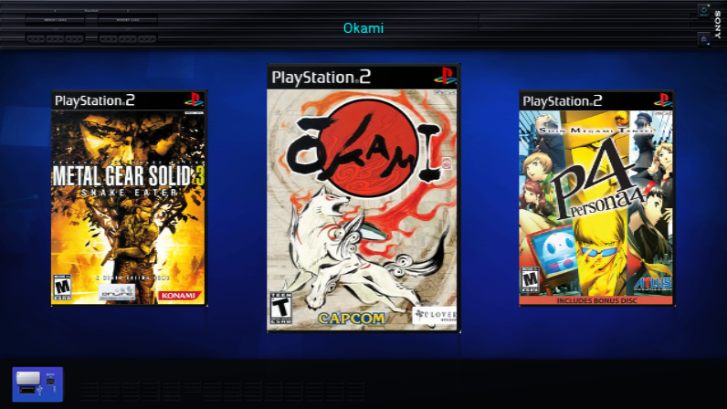 |

### PSBBN Flow

| Korium | IncebtIon |
| --- | --- |
|  | 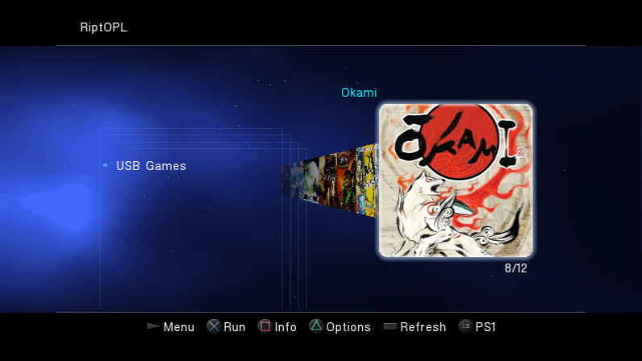 |

### Classic list

| Korium | IncebtIon |
| --- | --- |
|  | 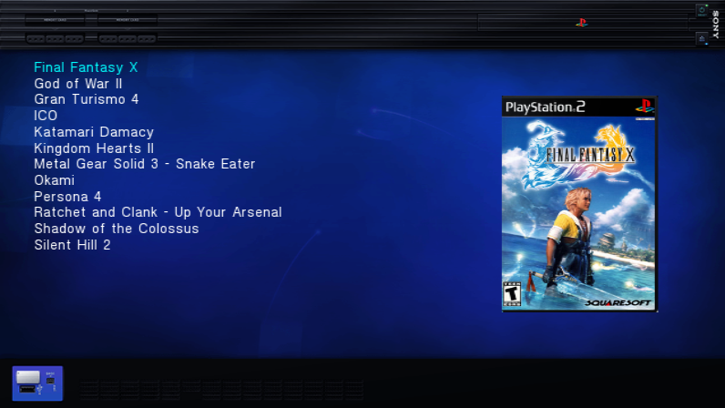 |

### Library in motion

Watch the 24-second library tour

| Korium | IncebtIon |
| --- | --- |
|  | 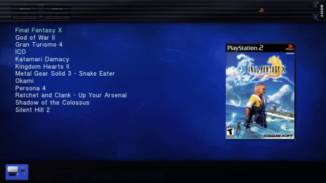 |

[Korium MP4](assets/ui/library-tour.mp4) / [IncebtIon MP4](assets/ui/incebtion/library-tour.mp4). Four authentic browsing takes joined with
straight cuts. PNGs preserve the complete 796 x 448 aspect-correct emulator output.
The video is scaled to 960 x 540 at 20 fps; the GIF is 640 x 360 at 8 fps.
The underlying interface is standard definition, not native HD.

### Game information

Each sample title has a completed Info page with title, genre, North American
release year, developer, an original description, video badges and two matching
screenshot-art panels. These are real loader captures. Screenshot artwork is
pre-existing OPL artwork displayed inside RiptOPL; no game was launched to capture it.

| Korium | IncebtIon |
| --- | --- |
|  | 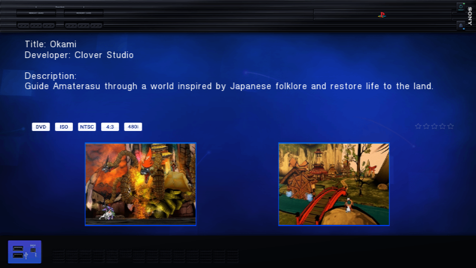 |

See all 12 completed Info pages

**Final Fantasy X**

| Korium | IncebtIon |
| --- | --- |
|  | 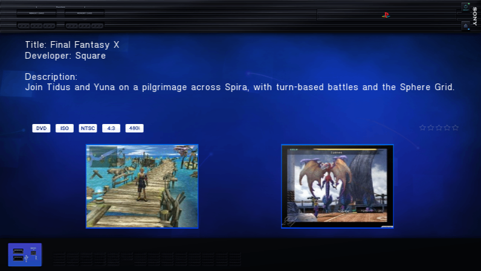 |

**God of War II**

| Korium | IncebtIon |
| --- | --- |
|  | 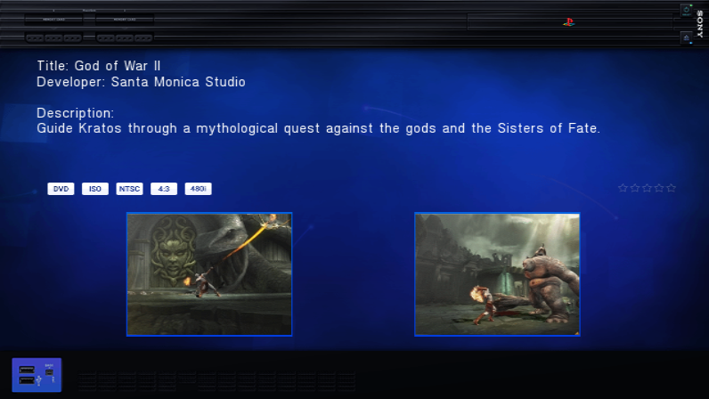 |

**Gran Turismo 4**

| Korium | IncebtIon |
| --- | --- |
|  | 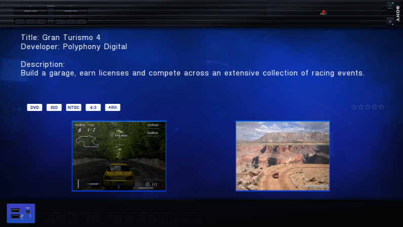 |

**ICO**

| Korium | IncebtIon |
| --- | --- |
|  | 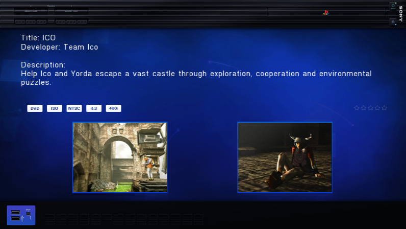 |

**Katamari Damacy**

| Korium | IncebtIon |
| --- | --- |
|  | 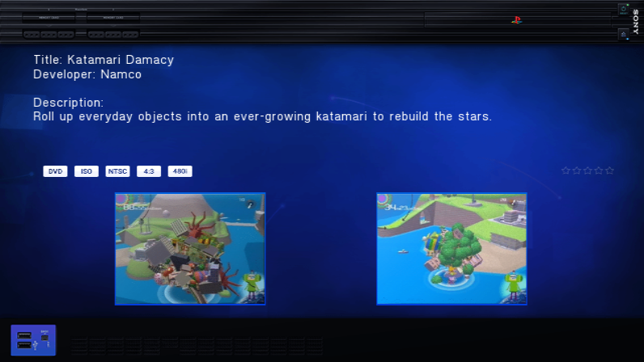 |

**Kingdom Hearts II**

| Korium | IncebtIon |
| --- | --- |
|  | 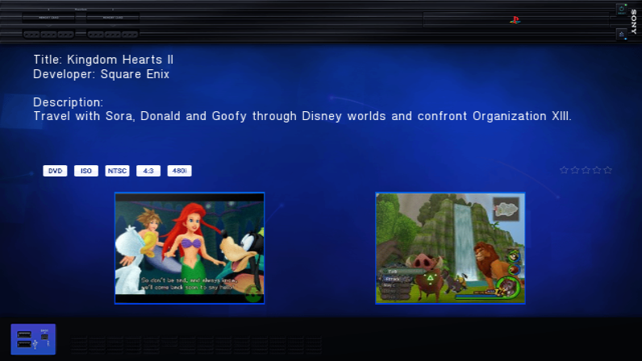 |

**Metal Gear Solid 3 - Snake Eater**

| Korium | IncebtIon |
| --- | --- |
|  | 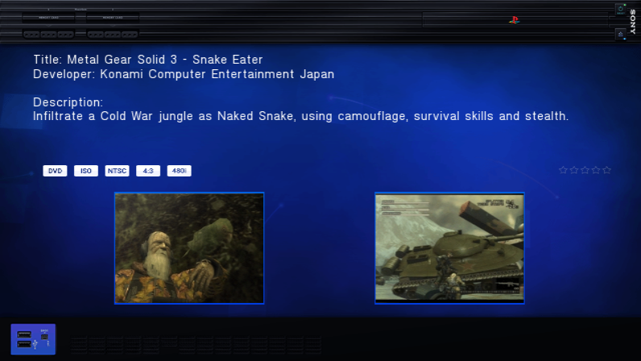 |

**Persona 4**

| Korium | IncebtIon |
| --- | --- |
|  | 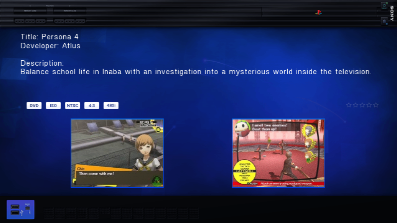 |

**Ratchet and Clank - Up Your Arsenal**

| Korium | IncebtIon |
| --- | --- |
|  | 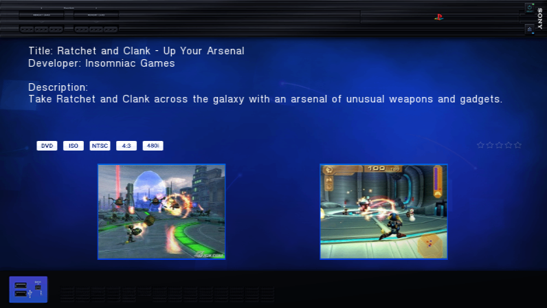 |

**Shadow of the Colossus**

| Korium | IncebtIon |
| --- | --- |
|  | 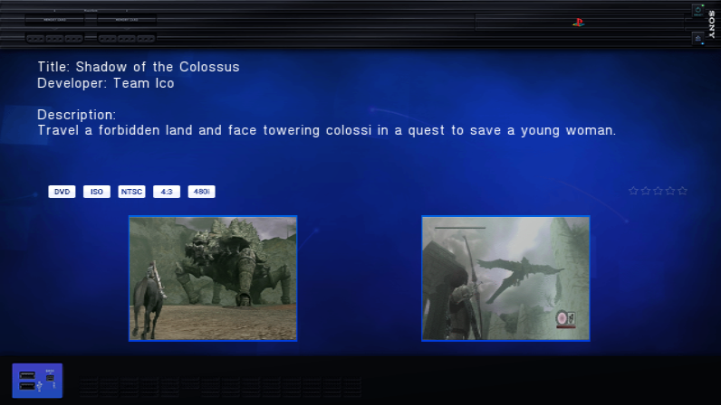 |

**Silent Hill 2**

| Korium | IncebtIon |
| --- | --- |
|  | 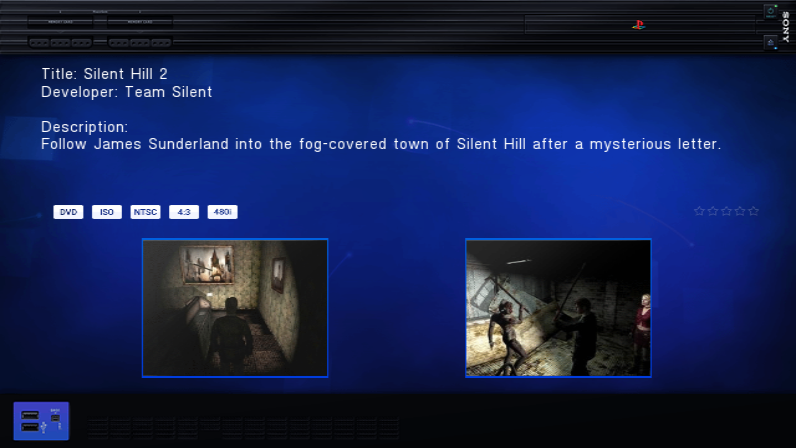 |

Watch Info navigation (20-second GIF)

| Korium | IncebtIon |
| --- | --- |
|  | 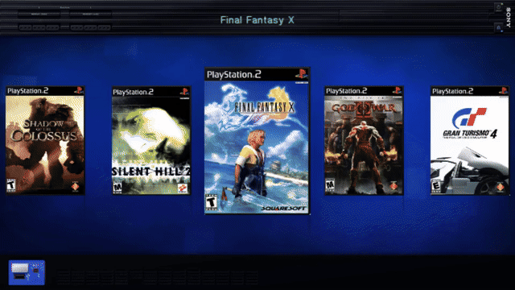 |

[Korium 30-second MP4](assets/ui/info-navigation.mp4) / [IncebtIon 30-second MP4](assets/ui/incebtion/info-navigation.mp4) | [Info capture and artwork manifest](assets/ui/info-manifest.json).
Release years use the North American PS2 releases. The video badges describe the
staged 4:3/480i metadata, not every mode a game supports. Unmeasured file sizes and
unassigned review ratings are not fabricated.

### Per-game controls

| Korium | IncebtIon |
| --- | --- |
|  | 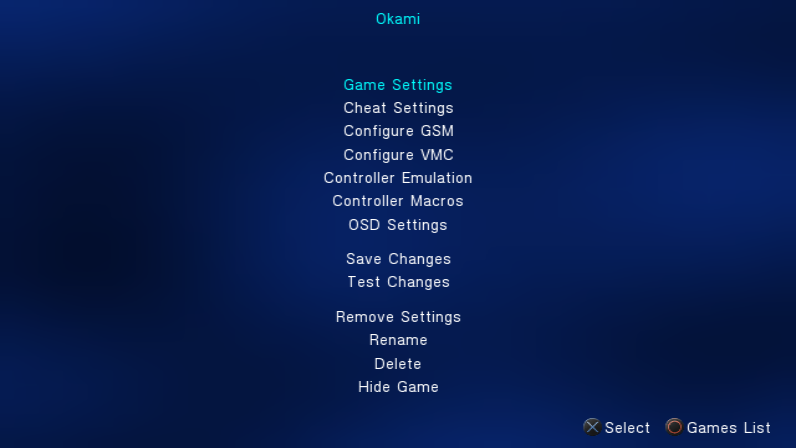 |

| Korium | IncebtIon |
| --- | --- |
|  | 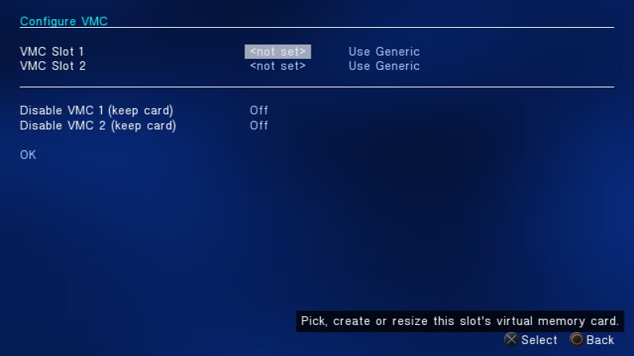 |

| Korium | IncebtIon |
| --- | --- |
|  | 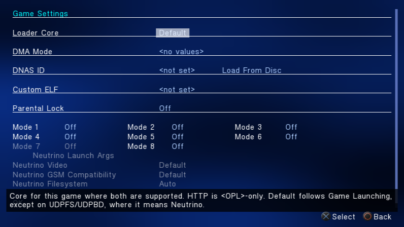 |

| Korium | IncebtIon |
| --- | --- |
|  | 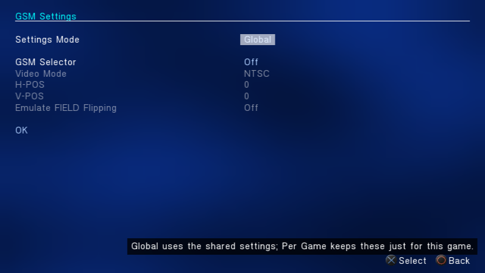 |

| Korium | IncebtIon |
| --- | --- |
|  | 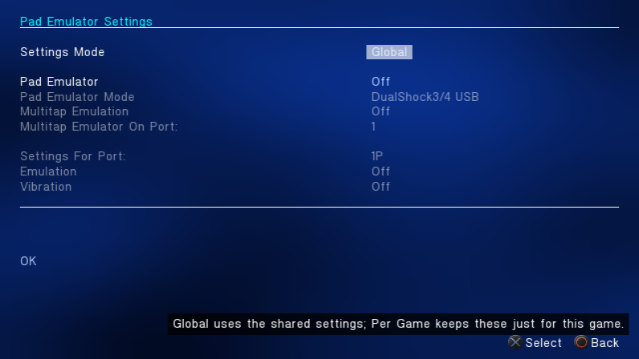 |

| Korium | IncebtIon |
| --- | --- |
|  | 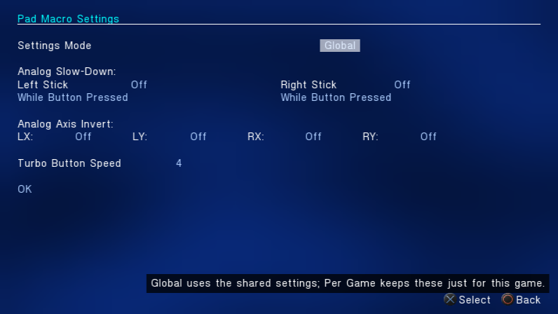 |

| Korium | IncebtIon |
| --- | --- |
|  | 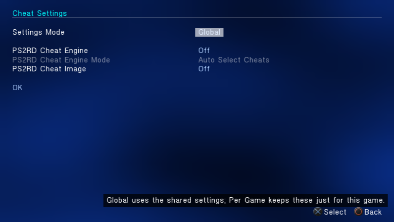 |

These settings are capture examples, not compatibility recommendations for these games.

### Artwork and quality

Covers come from [xlenore/ps2-covers](https://github.com/xlenore/ps2-covers), matched
by serial against PCSX2's GameIndex. The original cover files remain in the local lab;
256-pixel-wide Lanczos textures retain more detail than the displayed SD covers need
while keeping a complete sample collection loaded. Published PNGs are not retouched.
Artwork belongs to its respective owners.

The [showcase manifest](assets/ui/showcase-manifest.json) records source cover URLs,
hashes, build identity, sample titles and exact capture steps. The Info screenshots
use matching assets from the [OPL Manager artwork archive](https://github.com/Luden02/psx-ps2-opl-art-database),
pinned to a specific commit in the Info manifest. A grid take with a visible edge
artifact is excluded; all 12 Info pages are complete and included.

## Settings overview

| Korium | IncebtIon |
| --- | --- |
|  | 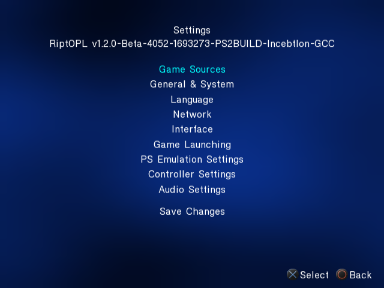 |

The category menu brings Game Sources, Network, Interface, Game Launching,
PS Emulation Settings, Controller Settings and Audio Settings into one place.

## Game Sources

| Korium | IncebtIon |
| --- | --- |
|  | 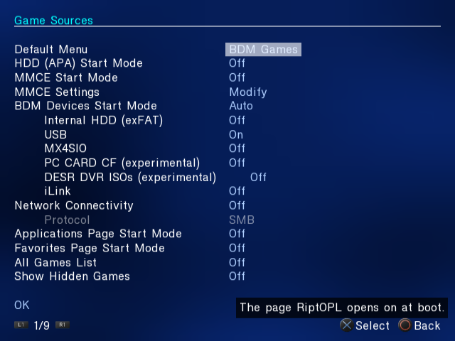 |

Configure which storage sources and library pages RiptOPL starts. The screenshot
uses an isolated capture configuration with USB enabled and other sources mostly
disabled; these values are
examples, not recommended settings for every installation.

## Interface

| Korium | IncebtIon |
| --- | --- |
|  | 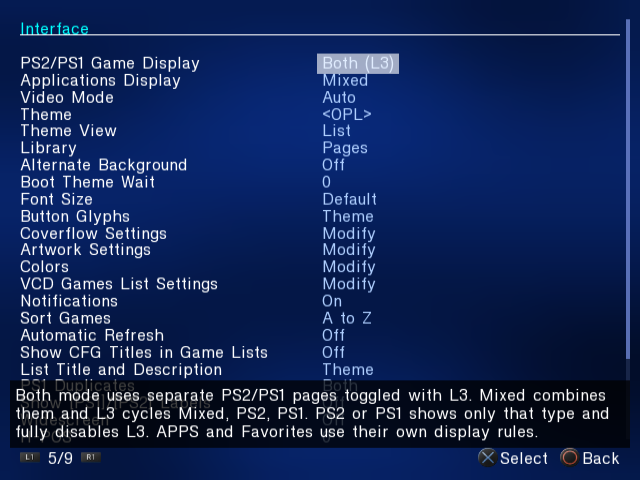 |

The Interface page groups display, theme, library and artwork controls.
The on-screen help describes the selected option.

## Settings in motion

Watch Settings navigation

| Korium | IncebtIon |
| --- | --- |
|  | 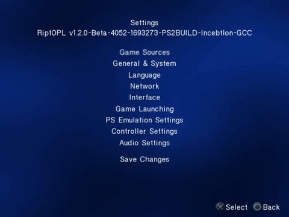 |

The [Korium MP4](assets/ui/settings-navigation.mp4) and
[IncebtIon MP4](assets/ui/incebtion/settings-navigation.mp4) show the same sequence at
640 x 480 and 20 frames per second. The GIF is 480 x 360 at
five frames per second. The PNGs retain the unmodified 640 x 480 emulator frames.

## Capture identity

- **Build:** Korium and IncebtIon v1.2.0-Beta-4052, source `a64f1b92a632a0c00ffdb9f67cbbd047b49dbaf0`.
- **Emulator:** RIPPCSX2 2.9.96-rippcsx2.2.
- **Display:** Auto/NTSC; 16:9 library and per-game captures, 4:3 settings captures.
- **Captured:** November 3, 2026.
- **Evidence:** menu rendering and navigation in an emulator. These captures do not establish
  physical-console, storage-device or gameplay acceptance.

The [Korium manifest](assets/ui/capture-manifest.json) and
[IncebtIon manifest](assets/ui/incebtion/capture-manifest.json) record the ELF and emulator
hashes, input sequence, media hashes and conversion settings. The media contains
no BIOS, memory-card image, game image or account information.

## Refreshing the images

1. Prepare an isolated portable RIPPCSX2 lab with its own settings, card and output
   folders. Keep it separate from an everyday emulator installation.
2. Put the edition's released `RIPTOPL.ELF` in the lab's program directory. In that
   directory's `settings_riptopl.cfg`, use `vmode=0` and `wide_screen=0` for the 4:3
   Settings captures; use `vmode=0` and `wide_screen=1` for the 16:9 library,
   Coverflow, PSBBN Flow, per-game and Info captures. These are lab settings, not
   recommended defaults.
3. Bind the pad keys expected by the [RIPPS2 background driver](https://github.com/akilluminati47/RIPPS2/blob/f4679198071ebc6d57461111f5a70ba3e268c2e0/tools/dev/ps2bg.ps1).
   The pinned driver hard-codes `$lab` to `B:\Emulation\PlayStation\PCSX2\ripps2-lab`.
   Update `$lab` in your copy to your isolated lab directory; the driver expects
   `pcsx2-qt.exe` there. Bind Screenshot to F8 and ToggleVideoCapture to F11.
   Capture the native emulator output: 640 x 480 for 4:3 Settings or 796 x 448 for
   16:9 views. The Settings MP4 remains 640 x 480; the widescreen library and Info
   MP4s are scaled to 960 x 540 for delivery, not captured as native HD.
4. Run the sequence recorded in the manifest. Use Windows-native backslash paths
   for the ELF on Windows. F8 captures the emulator output directly; F11 records it.
5. Inspect every screenshot and the full clip. Keep PNG frames unchanged; trim and
   encode the clip for web delivery. Refresh media byte sizes and SHA-256 hashes
   in each edition's capture manifest after every capture refresh, even when the build
   is unchanged. Refresh `release`, `source_commit` and `elf_sha256` when the
   RiptOPL build changes; independently refresh `emulator` and `emulator_sha256`
   whenever the RIPPCSX2 binary changes. Do not assume a matching loader build
   means the emulator is unchanged.
6. Keep `docs/assets/ui/` and the site's `assets/ui/` copies identical. Update captions,
   then regenerate the site's search index. The wiki home and repository guide use
   the same captures through the wiki builder. Match each edition by filename; the
Korium files retain their original URLs and IncebtIon lives in `incebtion/`.

The library, flow views, per-game settings and Info pages above use a repeatable
sample library. Keep its placeholder status explicit when refreshing those sets.
