# RiptOPL interface captures

These screenshots and clips show the real RiptOPL menu running in **RIPPCSX2**.
The collection covers library views, per-game controls and settings.

## Browse the collection

The showcase uses a virtual USB disk containing 12 **non-bootable placeholder files**.
RiptOPL scans the files and renders the matching art through its normal UI. No games
are distributed or launched in the published media.

### Five-cover carousel

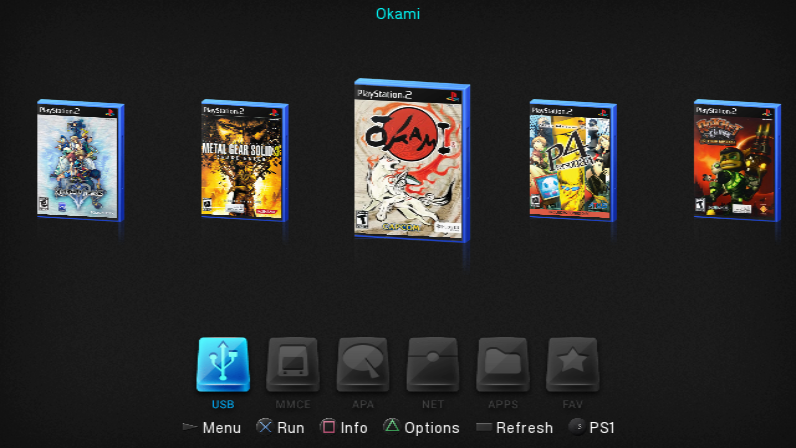

### Three-cover carousel

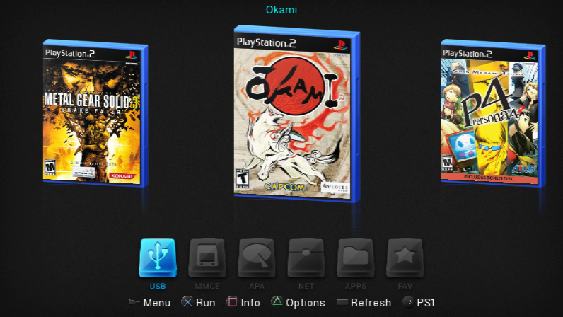

### PSBBN Flow

### Classic list

### Library in motion

Watch the 24-second library tour

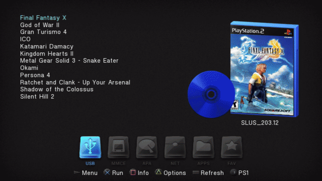

[Silent MP4](assets/ui/library-tour.mp4). Four authentic browsing takes joined with
straight cuts. PNGs preserve the complete 796 x 448 aspect-correct emulator output.
The video is scaled to 960 x 540 at 20 fps; the GIF is 640 x 360 at 8 fps.
The underlying interface is standard definition, not native HD.

### Game information

Each sample title has a completed Info page with title, genre, North American
release year, developer, an original description, video badges and two matching
screenshot-art panels. These are real loader captures. Screenshot artwork is
pre-existing OPL artwork displayed inside RiptOPL; no game was launched to capture it.

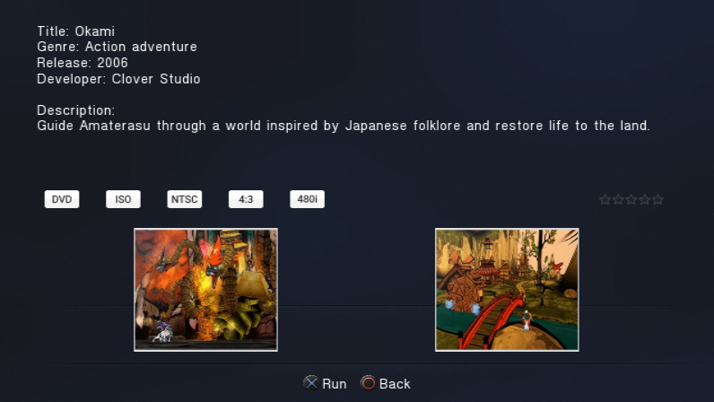

See all 12 completed Info pages

**Final Fantasy X**

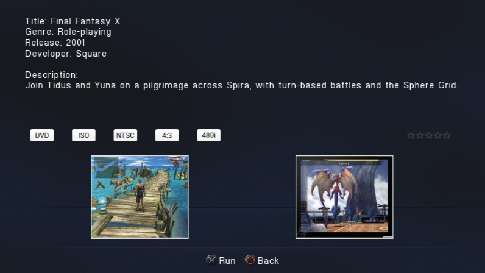

**God of War II**

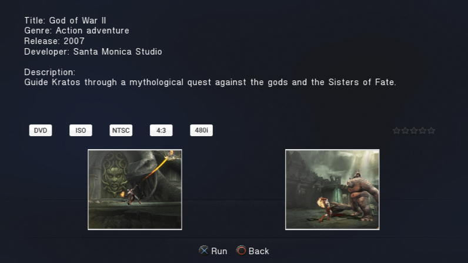

**Gran Turismo 4**

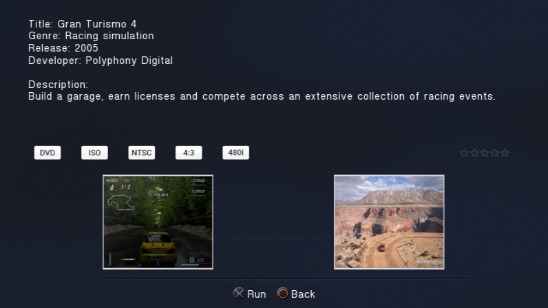

**ICO**

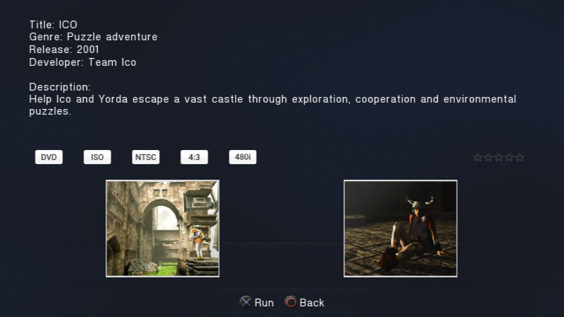

**Katamari Damacy**

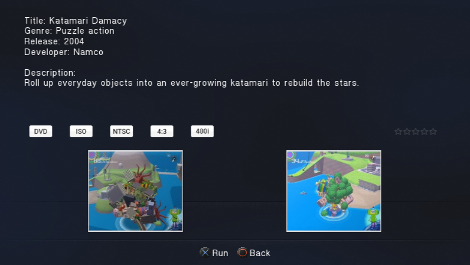

**Kingdom Hearts II**

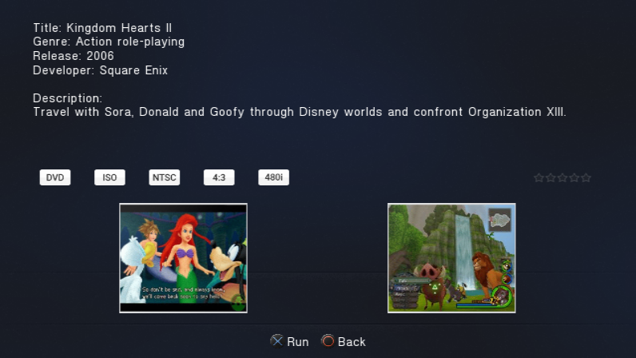

**Metal Gear Solid 3 - Snake Eater**

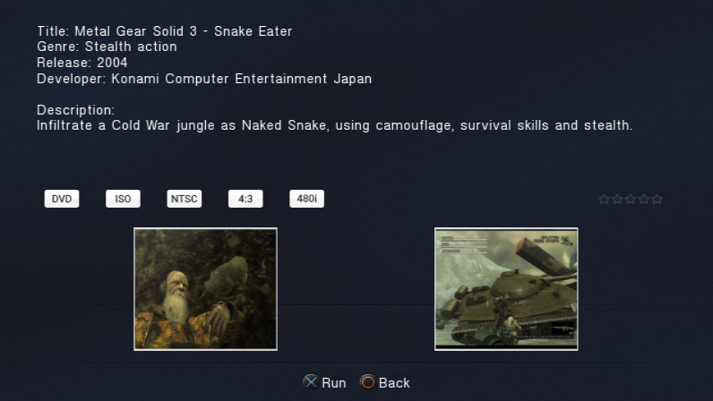

**Persona 4**

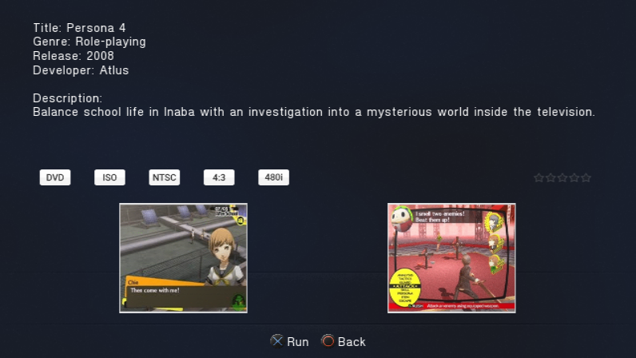

**Ratchet and Clank - Up Your Arsenal**

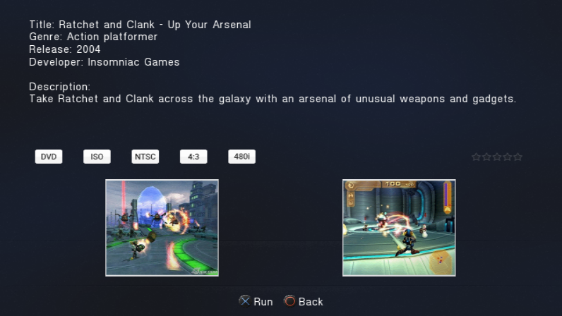

**Shadow of the Colossus**

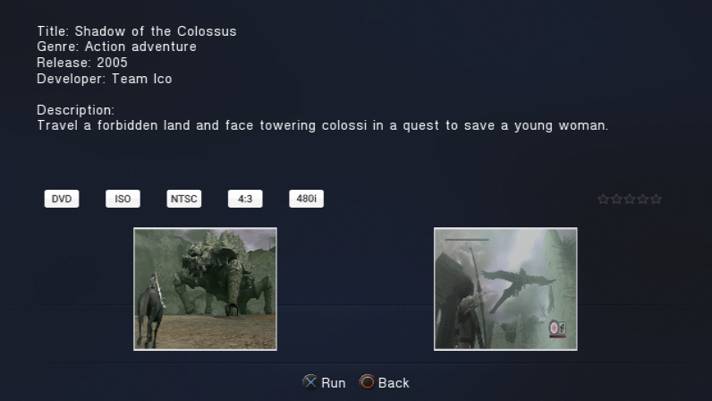

**Silent Hill 2**

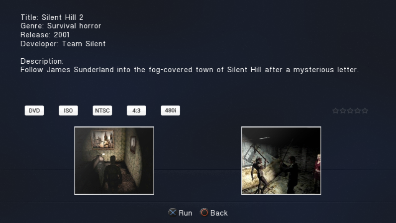

Watch Info navigation (20-second GIF)

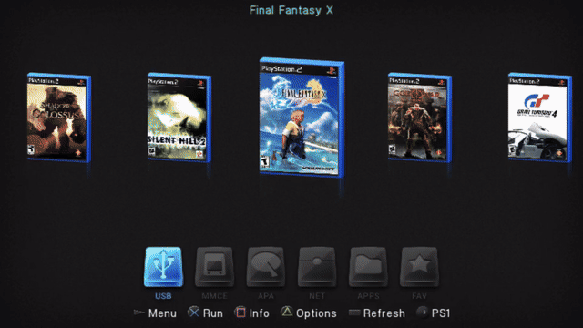

[30-second MP4](assets/ui/info-navigation.mp4) | [Info capture and artwork manifest](assets/ui/info-manifest.json).
Release years use the North American PS2 releases. The video badges describe the
staged 4:3/480i metadata, not every mode a game supports. Unmeasured file sizes and
unassigned review ratings are not fabricated.

### Per-game controls

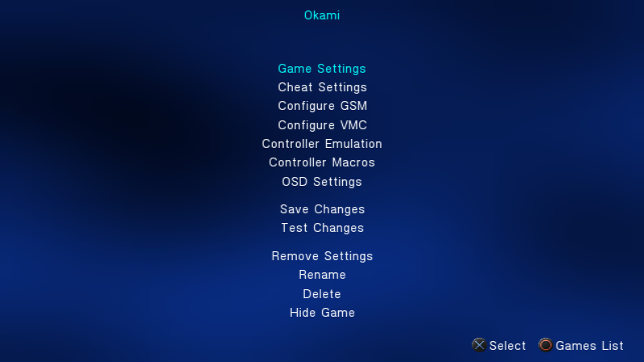

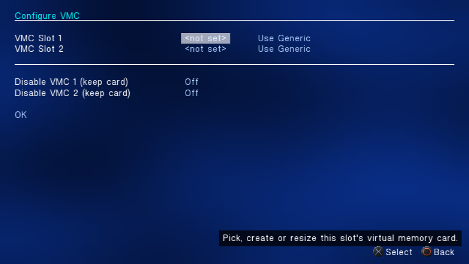

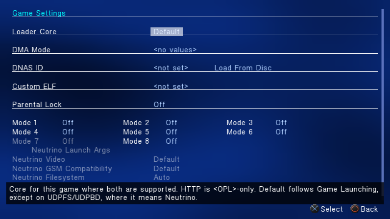

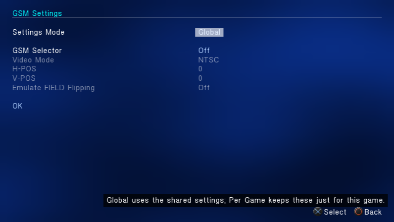

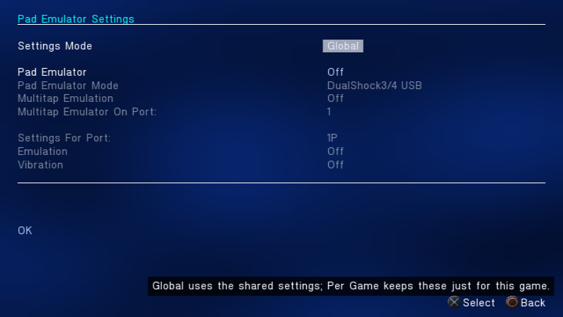

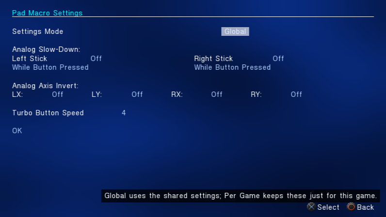

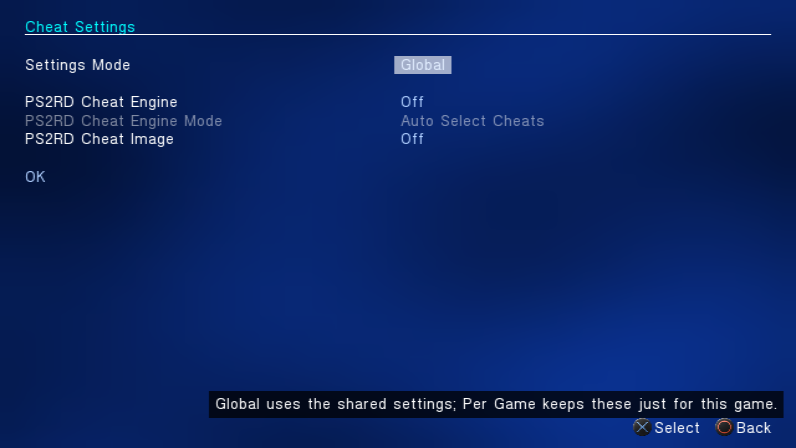

These settings are capture examples, not compatibility recommendations for these games.

### Artwork and quality

Covers come from [xlenore/ps2-covers](https://github.com/xlenore/ps2-covers), matched
by serial against PCSX2's GameIndex. The original cover files remain in the local lab;
256-pixel-wide Lanczos textures retain more detail than the displayed SD covers need
while keeping a complete sample collection loaded. Published PNGs are not retouched.
Artwork belongs to its respective owners.

The [showcase manifest](assets/ui/showcase-manifest.json) records source cover URLs,
hashes, build identity, sample titles and exact capture steps. The Info screenshots
use matching assets from the [OPL Manager artwork archive](https://github.com/Luden02/psx-ps2-opl-art-database),
pinned to a specific commit in the Info manifest. A grid take with a visible edge
artifact is excluded; all 12 Info pages are complete and included.

## Settings overview

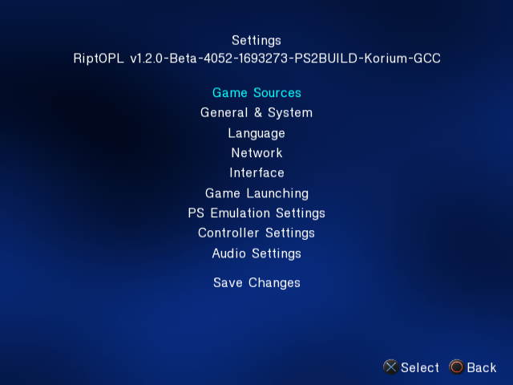

The category menu brings Game Sources, Network, Interface, Game Launching,
PS Emulation Settings, Controller Settings and Audio Settings into one place.

## Game Sources

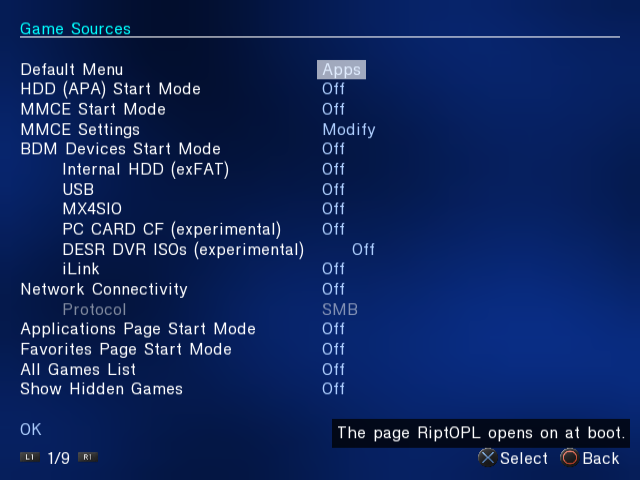

Configure which storage sources and library pages RiptOPL starts. The screenshot
uses an isolated capture configuration with sources disabled; these values are
examples, not recommended settings for every installation.

## Interface

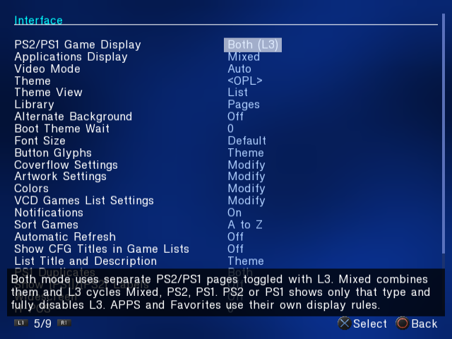

The Interface page groups display, theme, library and artwork controls.
The on-screen help describes the selected option.

## Settings in motion

Play the 14-second navigation GIF (2.3 MB)

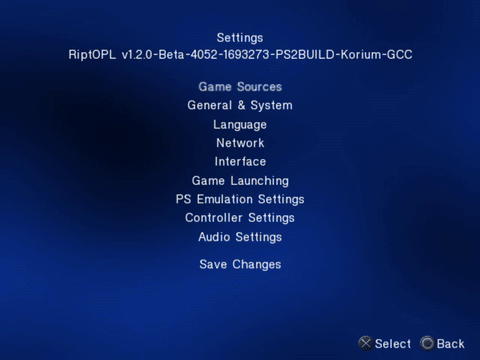

The [silent MP4](assets/ui/settings-navigation.mp4) shows the same sequence at
640 x 480 and 20 frames per second, using about 315 KB. The GIF is 480 x 360 at
five frames per second. The PNGs retain the unmodified 640 x 480 emulator frames.

## Capture identity

- **Build:** Korium v1.2.0-Beta-4045, source `22c319f72c046a583917fb73852f7de1d359bd8d`.
- **Emulator:** RIPPCSX2 2.9.96-rippcsx2.2.
- **Display:** Auto/NTSC; 16:9 library and per-game captures, 4:3 settings captures.
- **Captured:** November 3, 2026.
- **Evidence:** menu rendering and navigation in an emulator. These captures do not establish
  physical-console, storage-device or gameplay acceptance.

The [capture manifest](assets/ui/capture-manifest.json) records the ELF and emulator
hashes, input sequence, media hashes and conversion settings. The media contains
no BIOS, memory-card image, game image or account information.

## Refreshing the images

1. Prepare an isolated portable RIPPCSX2 lab with its own settings, card and output
   folders. Keep it separate from an everyday emulator installation.
2. Put the edition's released `RIPTOPL.ELF` in the lab's program directory. This set
   uses `vmode=0` and `wide_screen=0` in that directory's `settings_riptopl.cfg`.
3. Bind the pad keys expected by the [RIPPS2 background driver](https://github.com/akilluminati47/RIPPS2/blob/f4679198071ebc6d57461111f5a70ba3e268c2e0/tools/dev/ps2bg.ps1).
   Bind Screenshot to F8 and ToggleVideoCapture to F11. Select the emulator's
   internal screenshot resolution and 640 x 480 video output.
4. Run the sequence recorded in the manifest. Use Windows-native backslash paths
   for the ELF on Windows. F8 captures the emulator output directly; F11 records it.
5. Inspect every screenshot and the full clip. Keep PNG frames unchanged; trim and
   encode the clip for web delivery. Refresh the build label and hashes whenever
   the captured build changes.
6. Keep `docs/assets/ui/` and the site's `assets/ui/` copies identical. Update captions,
   then regenerate the site's search index. The wiki home and repository guide use
   the same captures through the wiki builder.

Future sets can show a populated library, Coverflow, PSBBN Flow and per-game
settings once a suitable, repeatable local library is prepared. Avoid presenting
placeholder files as working game installations.
